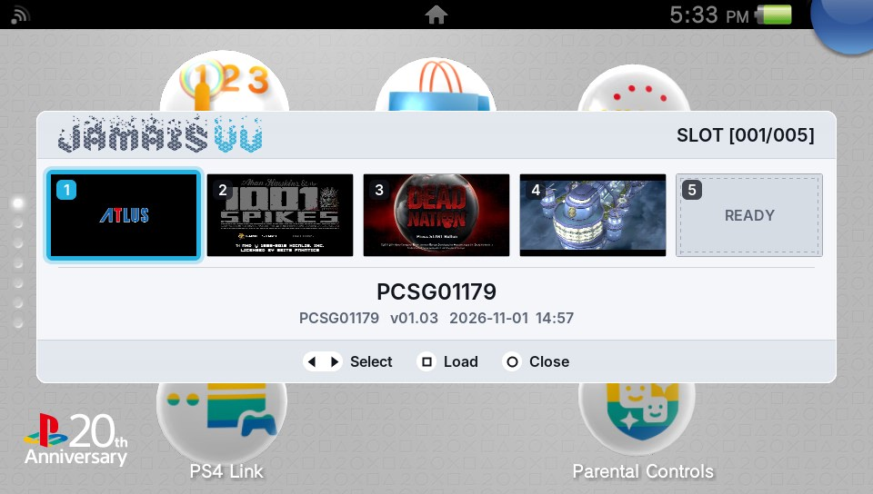

# JamaisVu: Vita SaveState Plugin

*JamaisVu* is a kernel plugin for the PlayStation Vita and PS TV that saves the whole system's state to the Memory Card at any moment and restores it later, so you can save anywhere, in any game. Open the menu, pick a slot, press save. Later, load the slot and the game continues from that exact moment.

It is based on TheFloW's déjàvu, with an on-screen slot menu, thumbnails and game names, a progress screen on every display, and a save/load path rewritten so that it cannot damage your Memory Card.



## Compatibility

| | |
| --- | --- |
| Firmware | **3.60**, tested on a PCH-1000 (OLED), a PCH-2000 and a PS TV. 3.65 has its offsets but has not been tested; other firmware is not supported and the plugin stays inactive there. |
| Storage | An **official Sony Memory Card**, mounted as ux0, or as uma0/xmc0 next to an SD2Vita, PSVSD or USB stick (StorageMgr, YAMT, gamesd, usbmc). |
| Space | **704 MB** of free space on the Memory Card per slot, up to 99 slots. |
| Games | Vita games, from inside the game or from the LiveArea. PSP and PS1 games are left alone. |

JamaisVu writes **only to the official Memory Card**: slot files, slot info, thumbnails, its log. It never writes to an SD2Vita, PSVSD, USB stick or the internal storage, so the worst a failure can cost is savestates. A card dedicated to savestates is ideal. Back up your Memory Card before relying on it.

## Installation

1. Copy `JamaisVu.skprx` to `ux0:tai/JamaisVu.skprx`.
2. Add it under `*KERNEL` in `ux0:tai/config.txt`:

   ```
   *KERNEL
   ux0:tai/JamaisVu.skprx
   ```

3. Optional, for Japanese game names: copy `jpfont.bin` to `ux0:data/JamaisVu/jpfont.bin` (or `uma0:data/JamaisVu/` if the card is uma0).
4. Reboot. `data/JamaisVu/status.txt` on the Memory Card says `status: armed` when the plugin is active, or why it is not.

**Updating:** a snapshot contains the whole system, JamaisVu included. After an update, reboot and save new slots; loading an older slot brings the older JamaisVu back until the next reboot.

## Usage

Press **START + UP** to open the menu; **START + UP** or **START + DOWN** closes it. Hold UP first, then press START, so the game never sees START on its own. The game keeps running underneath but no longer receives input.

| Button | Action |
| --- | --- |
| ◀ ▶ | Choose a slot (the row of five scrolls) |
| L R | Five slots back / forward |
| ✕ | Save to the selected slot (asks before overwriting) |
| □ | Load the selected slot (asks first) |
| ○ | Close |
| ✕ (LiveArea, empty slot) | Prepare the selected slot now |
| △ (LiveArea) | Prepare all empty slots there is space for |

✕ always confirms and ○ always goes back, whatever the game's region or any ✕/○ remap.

**Slots.** Each slot shows a thumbnail of the moment you saved, the game's name as your LiveArea shows it, its title ID, version and date. The menu shows as many slots as can exist: every slot that has a file, plus as many new ones as the free space allows; the counter reads `02/02` with room for two, `01/20` with room for twenty. A slot's file is created the first time you save to it, which takes a while longer; to avoid that wait in a game, prepare slots from the LiveArea (prepared slots show **READY**).

**Saving** takes about a minute. A progress screen shows how far it is, on the OLED, the LCD and over HDMI. Afterwards the game continues and a message confirms the save.

**Loading** works from inside a game and from the LiveArea. A snapshot only loads into the exact game version it was taken with; if the game was updated since, the slot is marked and cannot be loaded. Saving only works while a game is on screen; the LiveArea itself is never snapshotted.

**No lock screen** appears after a save or load; ordinary sleep still locks as usual.

During a save or load the **game card LED is on**. If it blinks rapidly, see [If a load fails](#if-a-load-fails).

## Savedata

A snapshot includes the running game's savedata, and loading a slot puts it back, so the game and its saves always agree. Progress made after the snapshot, saves included, is undone by a load, which is what a savestate is for.

The savedata is included when it lives on the Memory Card:

- the system's `user/00/savedata` folder, when the card is ux0;
- [reSavedata](https://github.com/Princess-of-Sleeping/reSavedata)'s `resavedata` folder, whenever that folder is on the card. The [Memory Card edition](https://github.com/delon5/reSavedata) of reSavedata puts it there automatically, on uma0 when a storage plugin has another drive on ux0.

When the savedata is on another drive (an SD2Vita, PSVSD or USB stick as ux0, without reSavedata on the card), a load restores the game but **not** its savedata, and the load prompt says so. A game may then see a save made after the snapshot as corrupt or overwrite it; nothing else is affected.

## Good to know

- **PSP and PS1 games** (LiveArea or Adrenaline) run in the Vita's PSP emulator; JamaisVu stays out of them. No menu opens and nothing is saved.
- **With a USB drive as ux0** (usbmc), the game comes back a few seconds later after a load than after a save: JamaisVu waits for the drive to return from the wake-up before re-reading it.
- **After a normal sleep** (power button), usbmc's Memory Card mount drops out. JamaisVu mounts the card again within about half a second of the wake-up.
- **Japanese game names** (kana and kanji) need `jpfont.bin` on the Memory Card; without it such names show their Latin letters or the title ID.
- **Dead Nation** tears its own frames, which breaks up the menu's picture there. Saving and loading work normally.
- **Slots from the original déjàvu** (`ux0:savestate/…`) cannot be loaded.
- **Every run is recorded** in `data/JamaisVu/log.txt` on the Memory Card (`log.old.txt` keeps the previous 64 KB). If something goes wrong, that file says what happened; please include it in a report.

## If a load fails

If the load fails **before** anything was changed (damaged snapshot, other card, …), the game simply continues and a message explains why. If the game card LED **blinks rapidly with a black screen**, the load failed part-way. Hold the power button to switch off, then switch on again.

A load replaces the entire memory of the system. The protections that keep that from corrupting the card, and the risks that remain, are described in [docs/design.md](docs/design.md).

## Building

Every push is built by GitHub Actions with the official VitaSDK (`.github/workflows/build.yml`); the `.skprx` files are attached to each run. A pushed tag `v<version>` builds the release and drafts a GitHub Release with the zip (`.github/workflows/release.yml`).

To build locally you need [VitaSDK](https://vitasdk.org) with taiHEN:

```bash
mkdir build && cd build
```

```bash
cmake .. && make
```

Release builds (`-DJAMAISVU_RELEASE=ON -DJAMAISVU_VERSION=2.0.0`) leave out the Diagnostics screen that development builds open with SELECT in the menu (reset test, dry run, display test, write test).

### Testing

The payload's save/load code is also built for the PC and run against an in-memory Memory Card holding a real exFAT filesystem (4K, 32K and 128K clusters). Needs `gcc` and `exfatprogs`:

```bash
tests/host/run.sh
```

It checks that a save changes only the slot file's sectors, that a load restores savedata, memory and the mediaid sector exactly, and that over a dozen kinds of corrupted, malicious, interrupted or foreign states are rejected without writing anything. `fsck.exfat` must report every image clean. `tests/host/preview.sh` renders the menu with the plugin's own drawing code.

## Technical details

The plugin hooks the soft reset (`kscePowerRequestSoftReset`) so that, while every resource is suspended, a payload runs at physical address `0x1C000000` with caches and the MMU disabled. Using [FatFs](http://elm-chan.org/fsw/ff/00index_e.html) and a Memory Card driver of its own, it writes (or restores) every page referenced by the page tables, plus a few hardware states, while showing its progress on the console's display. When the system resumes, the plugin refreshes the filesystem driver's view of the drives. The design notes in [docs/design.md](docs/design.md) cover the menu's drawing and the Memory Card protections; [docs/porting-3.60.md](docs/porting-3.60.md) describes how the 3.60 offsets were established.

## Credits

- Original plugin (déjàvu) by [TheFloW](https://github.com/TheOfficialFloW). If you enjoy his work you can support him on [patreon](https://www.patreon.com/TheOfficialFloW).
- Thanks to [xerpi](https://github.com/xerpi) and [motoharu](https://github.com/motoharu-gosuto) for their Memory Card research.
- Thanks to [xerpi](https://github.com/xerpi) for [vita-libbaremetal](https://github.com/xerpi/vita-libbaremetal) (MIT) and the Vita developer wiki pages that came out of it: the progress screen's display code (display link, display controller, clocks, I2C, the OLED and LCD panels, the HDMI bridge) was first built on his code and is now JamaisVu's own, written from those register pages and the system's own setup, with the register values his work established.
- Thanks to [Team Molecule](https://github.com/TeamMolecule) for their prior research.
- Lock screen skip uses the SceShell locations found by TheFloW for NoLockScreen ([VitaTweaks](https://github.com/TheOfficialFloW/VitaTweaks)).
- [reSavedata](https://github.com/Princess-of-Sleeping/reSavedata) by Princess of Sleeping (GPL-3.0).
- Thanks to Dark_AleX for pspstates, which inspired the original project.
- Menu font: [Inter](https://github.com/rsms/inter) (SIL Open Font License, see `plugin/gui/FONT_LICENSE.txt`).
- Japanese glyphs: [Noto Sans JP](https://fonts.google.com/noto/specimen/Noto+Sans+JP) (SIL Open Font License, see `plugin/gui/FONT_LICENSE_JP.txt`), rasterised by `tools/gen_jpfont.py`.

## License

MIT, see [LICENSE](LICENSE).
