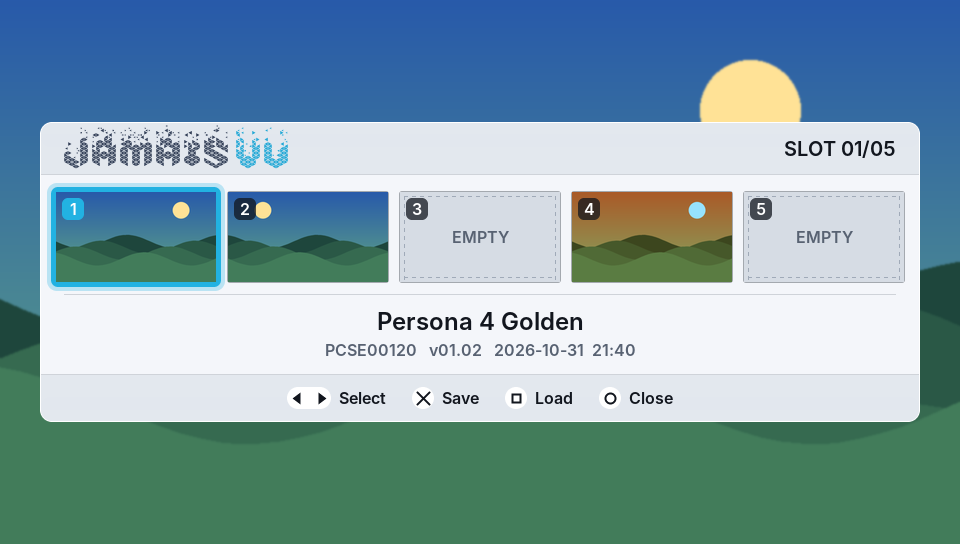

# JamaisVu: Vita SaveState Plugin

*JamaisVu* is a kernel plugin for the PlayStation Vita that takes a snapshot of the whole system's memory at any point and restores it later, so you can save in games where it is officially not possible. It is based on TheFloW's savestate plugin, with a new on-screen slot menu and a rewritten save/load path designed so that it cannot damage your Memory Card.



## Status

> **Untested on hardware.** Everything in this branch compiles, and the save/load logic passes an automated test suite against a real exFAT image (see [Testing](#testing)), but none of it has run on a Vita yet. Back up your Memory Card before trying it.

| Firmware | Status |
| --- | --- |
| 3.65 | Supported (the only firmware the original plugin was tested on) |
| 3.67, 3.68, 3.69–3.73 | Offsets present but **unverified**. Disabled unless built with `-DJAMAISVU_ALLOW_UNVERIFIED_FW=ON` |
| 3.60 | **Not supported yet.** The filesystem driver offsets for 3.60 still need to be found. See [docs/porting-3.60.md](docs/porting-3.60.md) |

On any firmware without a verified offset table, the plugin installs no filesystem hooks and changes nothing. SELECT + UP still opens the menu in **preview mode**, so the interface can be tried, but Save and Load explain why they are unavailable. `ux0:data/JamaisVu/status.txt` records the reason and the module NIDs it found. To help add 3.60, run the read-only [jvdump](tools/jvdump/README.md) plugin once and share its output.

## Requirements

- The official Sony Memory Card, mounted as **ux0 or uma0**. If uma0 exists (e.g. ux0 is an SD2Vita/PSVSD and the Memory Card was remapped to uma0), the slots are kept on uma0. The payload talks to the Memory Card hardware directly and verifies, with a token written by the OS, that it writes to the same slot file. If the Memory Card is not mounted at all, saving is refused.
  - With the Memory Card on uma0, the games' savedata lives on ux0, which the payload cannot reach: loading a slot restores the game but **does not roll back its savedata** (the load prompt says so).
- **704 MB of free space per slot.** Each slot is a fixed-size file that is created the first time you save to it. That first save takes a while longer (a progress bar is shown), and 64 MB are always left free.
- **Slots unlock with free space.** Slots you have already used stay available. Each new slot needs 704 MB: about 1 GB free unlocks one slot, 1.5 GB two, and so on. Locked slots show a padlock.

## Installation

1. Build or download `JamaisVu.skprx` and copy it to `ux0:tai/JamaisVu.skprx`.
2. Add it under `*KERNEL` in `ux0:tai/config.txt`:

   ```
   *KERNEL
   ux0:tai/JamaisVu.skprx
   ```

3. Reboot.

## Usage

Press **SELECT + UP** to open the slot menu. The game keeps running underneath but no longer receives input.

| Button | Action |
| --- | --- |
| ◀ ▶ | Choose one of the 5 slots |
| ✕ | Save to the selected slot (asks before overwriting) |
| □ | Load the selected slot (asks first) |
| ○ | Close |

Each slot shows a thumbnail of the game screen at the moment you saved, the game's name, its title ID and the date.

- **Saving** blacks out the screen for about a minute while memory is written to `data/JamaisVu/slotN.bin` on the Memory Card (uma0 or ux0). Afterwards the game continues, and a message confirms the save or explains why it failed.
- **Loading** works from inside a game and from the **LiveArea**. Saving does not: Save only appears when a running game is on screen, and this is checked again right before the save starts. A game suspended in the background doesn't count, so the LiveArea/shell can never be snapshotted.
- During save and load **the game card LED is on**. If it **blinks rapidly**, see [If a load fails](#if-a-load-fails).

A savestate contains the savedata of the games that were running. Loading a slot puts that savedata back, so progress made after the snapshot is lost.

Slots from the original dejavu plugin (`ux0:savestate/…`, format v1) cannot be loaded.

## How it keeps the Memory Card safe

The original README warned that *"your SD Card and/or Memory Card may be corrupted"*. This version addresses each known cause.

**Saving cannot change the filesystem.**
- The slot file is created and sized by the Vita's own exFAT driver *before* the snapshot, so all filesystem metadata is written by the OS.
- The payload looks up exactly which sectors belong to that file.
- A sector write guard (`payload/guard.c`) blocks every write outside those sectors before it reaches the card driver.

**An interrupted save is never loadable.**
- The header sector is cleared first and written last, with CRCs over the header and all metadata.
- A slot only counts as used once its `.jvi` info file is written, which happens after the save succeeds.

**Nothing is written until the whole file has been checked.** Before a load touches the card, it verifies:
- the header CRC and body CRC
- every savedata path (only `ux0:user/00/savedata/<TITLEID>/…`; no `..`)
- every memory segment (only DRAM/VRAM and the two known system regions)
- that the state was made on the same Memory Card

A corrupted or tampered state is rejected with nothing changed.

**Load writes are fenced.**
- Savedata restore can only write inside ux0's exFAT area, never the partition table or boot sectors.
- The mediaid sector is restored only to the sector it came from, and can no longer fall back to sector 0 (the MBR), which the original could.

**The restored OS cannot write with stale caches.** The payload arms a write block *inside the restored memory image*. The plugin remounts ux0 from the card before writes are allowed again. If a file that was open at snapshot time no longer exists, ux0 stays **read-only until restart** rather than risk writing to the wrong clusters.

**Unsupported firmware is never patched.** The original hooked 3.65 offsets on every firmware. On 3.60 that means patching random instructions inside the filesystem driver.

**Driver fixes.**
- Card transfers are split into ≤128 sectors (the original could send a wrong sector count for transfers above 255 sectors).
- The payload clears its `.bss` at startup, and several buffer overflows are fixed.

### What is still not guaranteed

No software can promise "100 %". These are the remaining risks:

- **Hardware testing.** See *Status* above.
- **Load is inherently invasive.** It replaces the entire OS memory. The ux0 remount (`plugin/fs.c`, inherited from the original) refreshes the exFAT driver's caches, but it is reverse-engineered code. JamaisVu's protections make an inconsistency fail safe (read-only) rather than silently corrupt, but it can't rule out every bug in that path.
- **A card I/O error in the middle of a load.** The payload stops (the LED blinks) instead of resuming a half-restored system. Savedata of the loaded game may be partially restored, as after a power cut.

### If a load fails

If the load fails **before** anything was changed (damaged snapshot, other card, …), the game simply continues and a message explains why. If the game card LED **blinks rapidly with a black screen**, the load failed part-way. Hold the power button to switch off, then switch on again.

## Building

Every push is built by GitHub Actions with the official VitaSDK (`.github/workflows/build.yml`). The `.skprx` files are attached to each run as an artifact.

To build locally you need [VitaSDK](https://vitasdk.org), which includes taiHEN.

```bash
mkdir build && cd build
```

```bash
cmake .. && make
```

### Testing

The payload's save/load code is also built for the PC and run against an in-memory Memory Card holding a real exFAT filesystem (exFAT with 4K, 32K and 128K clusters). Needs `gcc` and `exfatprogs`:

```bash
tests/host/run.sh
```

It checks that a save changes only the slot file's sectors, that a load restores savedata, memory and the mediaid sector exactly, and that over a dozen kinds of corrupted, malicious, interrupted or foreign states are rejected without writing anything. `fsck.exfat` must report every image clean.

`tests/host/preview.sh <background.png> <outdir>` renders the menu with the plugin's own drawing code (images in `docs/menu-preview`).

## Technical details

The plugin hooks the soft reset (`kscePowerRequestSoftReset`) so that, while every resource is suspended, a payload runs at physical address `0x1C000000` with caches and the MMU disabled. Using [FatFs](http://elm-chan.org/fsw/ff/00index_e.html) and a reverse-engineered Memory Card driver, it writes (or restores) every page referenced by the page tables, plus a few hardware states. When the system resumes, the plugin refreshes the filesystem driver's view of ux0.

## Credits

- Original plugin (déjàvu) by [TheFloW](https://github.com/TheOfficialFloW). If you enjoy his work you can support him on [patreon](https://www.patreon.com/TheOfficialFloW).
- Thanks to [xerpi](https://github.com/xerpi) and [motoharu](https://github.com/motoharu-gosuto) for their Memory Card research.
- Thanks to [xerpi](https://github.com/xerpi) for [vita-libbaremetal](https://github.com/xerpi/vita-libbaremetal).
- Thanks to [Team Molecule](https://github.com/TeamMolecule) for their prior research.
- Thanks to Dark_AleX for pspstates, which inspired the original project.
- Menu font: [Inter](https://github.com/rsms/inter) (SIL Open Font License, see `plugin/gui/FONT_LICENSE.txt`).
